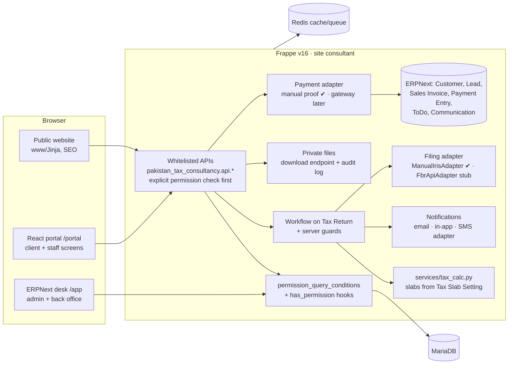
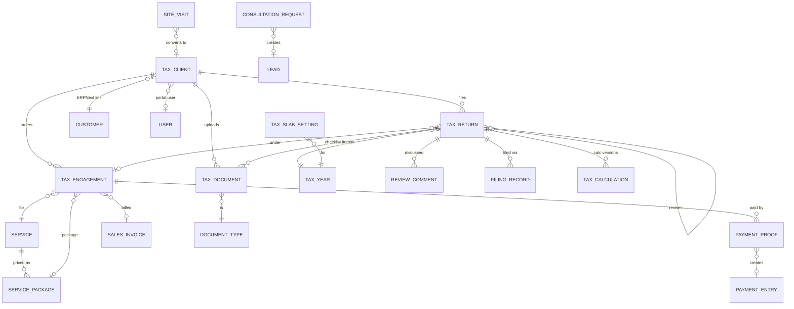

# Pakistan Tax Consultancy — Plan (Phase 0)

Spec: `TAX_PORTAL_AGENT_PROMPT.md` (bench root). Site `consultant`, app `pakistan_tax_consultancy`.
Status date: 2026-10-16. Nothing in this plan has been built yet; it waits for approval.

## 1. Environment

| Item | Value | Frappe v16 needs |
|---|---|---|
| Frappe / ERPNext | 16.34.0 / 16.35.0 (`version-16`) | — |
| Python | 3.14.7 | >=3.14,<3.15 ✔ |
| Node | 24.21.0 | >=24 ✔ |
| MariaDB | 10.6.23 | ✔ |
| Redis | 6.0.16 | ✔ |
| frappe-react-sdk | 1.17.1 | ✔ |
| Site apps | frappe, erpnext, pakistan_tax_consultancy | only this site has the app |

Findings:

- **Blog:** v16 core has `Web Page`, `Web Form` and `Website Settings`, but **no `Blog Post`** DocType. The blog becomes our own `Tax Update` DocType, rendered by www pages.
- **SPA serving:** a hand-made Vite build (as in realestate/solar) is enough, so Doppio isn't needed. `vite build` writes to `public/frontend/`; `www/portal.html` loads it; `website_route_rules` maps `/portal/<path>` to it.
- **Dev ports (decided):** the portal keeps Vite on **:5180** and the desk runs on **:8010** (`bench --site consultant serve --port 8010`). Both run outside the Procfile today; logs go to `logs/consultant_ui.log` and `logs/web_consultant.log`. Solar's UI is also set to 5180 with `--strictPort`, so the two can't run at the same time. Solar's config is left untouched.
- **Running processes** cache app code: restart `bench start` after this plan's migrations.

## 2. Architecture



## 3. Data model

New in **bold**. Renamed DocTypes already carry the spec names.



| DocType | Status |
|---|---|
| Tax Client, Site Visit, Service, Document Type, Tax Document, Tax Engagement, Tax Return (+ child tables), Tax Year, Tax Slab Setting, Filing Record, Tax Calculation, Tax Review, Tax Approval, Tax Audit Event, Tax Consultancy Settings | exist; fields to complete per §8 |
| **Service Package**, **Review Comment**, **Consultation Request**, **Payment Proof**, **Firm Website Settings** (single), **FAQ**, **Testimonial**, **Tax Update** (blog), **Promo Code**, **OTP Request**, **Portal Invite** | new |
| Tax Return child tables | split `Tax Return Payment` into **Tax Return Withholding** and **Tax Return Advance Tax**; add **Tax Return Personal Expense** |

## 4. Permission matrix

R read · W write · C create · D delete · E export. "Own" means the server-side query condition limits the user to their own records:

- **Client:** clients where `portal_user` is the user.
- **Consultant:** clients where `assigned_consultant` is the user.
- **Field Officer:** visits and clients where `field_officer` is the user.
- **Reviewer / Approver / Filing Officer:** returns where they are the assigned user, or that are sitting in their queue state.

| DocType | System Mgr | Tax Admin | Consultant | Reviewer | Approver | Filing Officer | Field Officer | Client |
|---|---|---|---|---|---|---|---|---|
| Tax Client | RWCDE | RWCDE | RWC own | R own | R own | R own | RC own | R own (profile W) |
| Site Visit | RWCDE | RWCDE | RW own | — | — | — | RWC own | — |
| Tax Engagement | RWCDE | RWCDE | RWC own | R own | R own | R own | — | RC own (via order API) |
| Tax Document | RWCDE | RWCDE | RWC own | RW own (verify) | R own | R own | C own | RC own (upload only) |
| Tax Return | RWCDE | RWCDE | RWC own | RW own | RW own | RW own | — | R own (summary + confirm API) |
| Review Comment | RWCD | RWCD | RWC own | RWC own | RC own | R own | — | C own (ask a question) |
| Filing Record | RWCDE | RWCDE | R own | R own | R own | RWC own | — | R own |
| Payment Proof | RWCDE | RWCDE | R own | — | — | — | — | RC own |
| Service, Service Package, Document Type, FAQ, Testimonial, Tax Update | RWCD | RWCD | R | R | R | R | R | R (published only, via www) |
| Tax Year, Tax Slab Setting | RWCD | RWCD | R | R | R | R | — | — |
| Consultation Request | RWCDE | RWCDE | RW own | — | — | — | — | Guest C (web form API) |
| Settings (both) | RW | RW | — | — | — | — | — | — |
| Tax Audit Event | R | R E | — | — | — | — | — | — |

Rules:

- **Export:** only Tax Admin and System Manager can export.
- **Field levels:** CNIC, bank and wealth fields are permlevel 1. Consultant, Reviewer and Approver can read them on their own records. CNIC is masked in list views (`*****-*******-3`).
- **APIs:** every whitelisted API checks permission first.
- **Dashboard summary:** it currently aggregates *all* returns for every caller. It will be scoped in Phase 2.

## 5. Workflow (Tax Return)

```
Documents Pending → Draft → Pending Review → Under Review → Changes Required → Draft
Under Review → Reviewed → Awaiting Client Confirmation → Approved
Approved → Submitted to FBR → Acknowledged → Closed
Submitted to FBR → Filing Error → Submitted to FBR (retry)
```

| From | To | Who | Server guard |
|---|---|---|---|
| Documents Pending | Draft | system / Consultant | every required checklist document is Verified |
| Draft | Pending Review | Consultant | required fields complete, all required documents Verified, calculation current (input hash matches) |
| Pending Review | Under Review | Reviewer | reviewer assigned (self-assign) |
| Under Review | Changes Required | Reviewer | Review Comment required |
| Changes Required | Draft | Consultant | — |
| Under Review | Reviewed | Reviewer | review checklist complete |
| Reviewed | Awaiting Client Confirmation | Reviewer | client has a portal user |
| Awaiting Client Confirmation | Approved | Approver | client confirmed (timestamp + IP stored); stores `content_hash` of material fields |
| Awaiting Client Confirmation | Draft | Client ("Ask a question") | question saved as a Review Comment |
| Approved | Submitted to FBR | Filing Officer | `content_hash` still matches; creates a Filing Record (Manual IRIS) |
| Submitted to FBR | Acknowledged | Filing Officer | **IRIS acknowledgment no. + receipt file required** |
| Submitted to FBR | Filing Error | Filing Officer | error text required; team notified |
| Filing Error | Submitted to FBR | Filing Officer | retry note |
| Acknowledged | Closed | Tax Admin | — |

Further rules:

- **After approval:** if any material figure changes, `validate` clears the approval and moves the return back to Pending Review.
- **Filed returns:** a filed return is never edited. "Revise" creates a new linked return of type Revised.
- **Logging:** every transition writes a Tax Audit Event (who, when, from/to, comment) and fires a notification.
- **Existing returns:** none yet. A patch maps the old states anyway: Submitted → Pending Review, Rejected → Changes Required, Filed → Submitted to FBR. A return never becomes Acknowledged without evidence.

## 6. Phases

Each phase covers the following:

- **Before:** `backup --with-files`, then the build.
- **Checks:** tests, plus curl checks run as different users.
- **Handover:** commit, then the commands you can run to check it yourself and the known gaps.
- **Stop:** only when a decision from you is needed.

| # | Scope | State | You can test after it |
|---|---|---|---|
| 0 | Inspect + this plan | **done** (this doc) | — |
| 1 | Site/app/roles/settings/fixtures | **mostly done**: app renamed, roles + DocTypes on spec names. Left: Firm Website Settings, fixtures for Workflow/Notifications/Print Formats/Number Cards | desk on `:8010`, portal on `:5180`; `bench --site consultant list-apps` |
| 2 | Tax Client + Site Visit completion, CSV import with dry run, duplicate detection, portal invite, sign-up + OTP (console SMS) + email verify, rate limits, role redirect; scope the dashboard API | partial (client/visit/duplicates exist) | sign up as a client, OTP shows in the log; import a CSV; convert a visit |
| 3 | Document Types per client type/service, checklist auto-generation, private upload/download endpoint + audit, verify/reject with reason | partial | upload as a client, reject as staff, re-upload; Draft is blocked until docs are verified |
| 4 | Engagement + packages, Tax Return child-table split, Tax Year/Tax Slab Setting (DEMO slabs marked NOT VERIFIED), `services/tax_calc.py` with versioned results | partial | create a return, enter income, see payable/refund for TY2026 |
| 5 | 12-state workflow + guards, client confirm, approval hash + auto-cancel, Filing Record, IRIS acknowledgment, filing error/retry, revisions, ManualIrisAdapter + FbrApiAdapter stub | old 6-state version exists | walk one return Draft → Acknowledged with each demo user; forbidden curl calls fail |
| 6 | Portal client screens: progress tracker, order package, questionnaire, checklist/upload (camera), summary confirm/ask, messages, invoices/payment proof, downloads; served at `/portal` | not started | full client journey on a phone-width browser |
| 7 | Portal staff screens: dashboard, client directory/import/invite, visit form, Tax Return wizard with autosave, all queues, consultation requests, payments to verify | partial (shell, lists, queues, launcher) | consultant prepares a return end to end |
| 8 | Public website: home (all 10 sections), services, pricing, salary calculator, booking, FAQ (schema), Tax Updates, about/contact, legal drafts, SEO, sitemap/robots, WhatsApp button | not started | Lighthouse mobile ≥85 perf / ≥90 a11y |
| 9 | Manual payments → Sales Invoice + Payment Entry, promo codes, 10 reports, 13 notifications | not started | upload proof → staff verify → client sees Paid |
| 10 | Urdu (RTL, Noto Nastaliq) on www + portal, performance, security review, full test run incl. client isolation | not started | toggle to Urdu; test report |
| 11 | README, ADMIN_GUIDE, GO_LIVE (written, not run) | not started | — |
| — | Payment gateway (spec §13 Phase 2) | research + options for you after Phase 9 | — |

Demo data (`pakistan_tax_consultancy.setup.demo.create_demo_data`): one user per role, salaried/business/AOP/company clients, fake CNICs `00000-0000000-0`. It is built in Phase 2 and grows each phase.

## 7. Decisions needed from you

1. **Firm details (§2):** firm name, phone/WhatsApp, email, office address, domain. Until you send them, placeholders marked `<FILL>` will show in settings. The website (Phase 8) needs them.
2. **Audit records:** keep the extra Tax Calculation / Tax Review / Tax Approval records as an audit trail next to the spec's fields on Tax Return (recommended), or drop them.
3. **Payment table:** split `Tax Return Payment` into Withholding + Advance Tax tables as the spec says (recommended).
4. **Work start:** should work start before or after payment? This is the default for the setting in §13.

Unless you say otherwise, I'll take the recommended options and start Phase 1's leftovers, then Phase 2.
